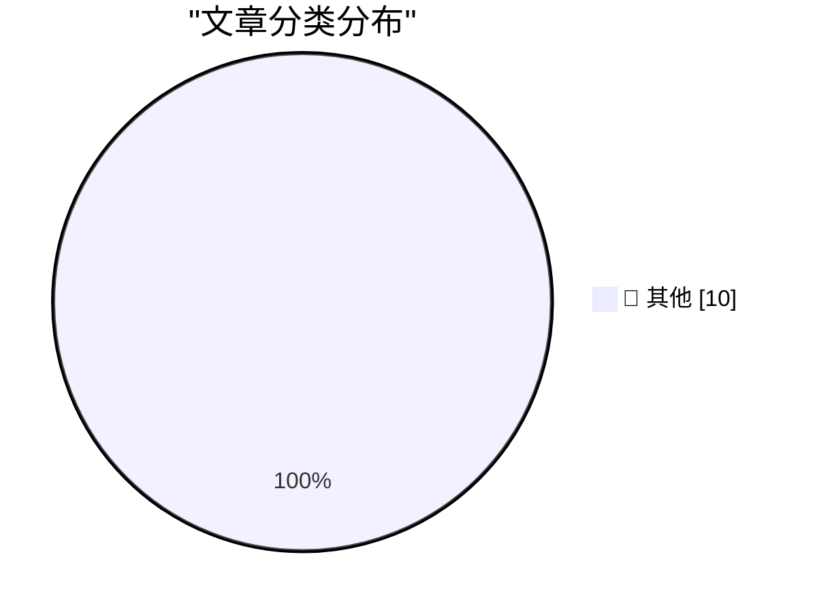

# 📰 AI 博客每日精选 — 2026-11-07

> 来自 Karpathy 推荐的 92 个顶级技术博客，AI 精选 Top 10

## 🏆 今日必读

🥇 **Working with designers**

[Working with designers](https://seangoedecke.com/working-with-designers/) — seangoedecke.com · 刚刚 · 📝 其他

> I love working with designers, in part because (unlike managers and product managers) they’re culturally different from engineers. However, having more than one designer on a team is asking for troubl

🥈 **★ Touch and Glow**

[★ Touch and Glow](https://daringfireball.net/2026/11/touch_and_glow) — daringfireball.net · 3 小时前 · 📝 其他

> By John Gruber Archive The Talk Show Dithering Projects Contact Colophon Feeds / Social Twitter --> Sponsorship OurCal : Shared calendar. Meet messenger. Touch and Glow Friday, 6 November 2026 I’m not

🥉 **Quoting Nilay Patel**

[Quoting Nilay Patel](https://simonwillison.net/2026/Nov/6/nilay-patel/) — simonwillison.net · 6 小时前 · 📝 其他

> Simon Willison’s Weblog Newsletter 6th November 2026 The products aren't good enough to sell people on the costs. You cannot tell people that you have to listen to the whine of a data center in their 

---

## 📊 数据概览

| 扫描源 | 抓取文章 | 时间范围 | 精选 |
|:---:|:---:|:---:|:---:|
| 78/92 | 2347 篇 → 16 篇 | 24h | **10 篇** |

### 分类分布

---

## 📝 其他

### 1. Working with designers

[Working with designers](https://seangoedecke.com/working-with-designers/) — **seangoedecke.com** · 刚刚 · ⭐ 15/30

> I love working with designers, in part because (unlike managers and product managers) they’re culturally different from engineers. However, having more than one designer on a team is asking for troubl

---

### 2. ★ Touch and Glow

[★ Touch and Glow](https://daringfireball.net/2026/11/touch_and_glow) — **daringfireball.net** · 3 小时前 · ⭐ 15/30

> By John Gruber Archive The Talk Show Dithering Projects Contact Colophon Feeds / Social Twitter --> Sponsorship OurCal : Shared calendar. Meet messenger. Touch and Glow Friday, 6 November 2026 I’m not

---

### 3. Quoting Nilay Patel

[Quoting Nilay Patel](https://simonwillison.net/2026/Nov/6/nilay-patel/) — **simonwillison.net** · 6 小时前 · ⭐ 15/30

> Simon Willison’s Weblog Newsletter 6th November 2026 The products aren't good enough to sell people on the costs. You cannot tell people that you have to listen to the whine of a data center in their 

---

### 4. Static site generators are weird

[Static site generators are weird](https://evanhahn.com/static-site-generators-are-weird/) — **evanhahn.com** · 6 小时前 · ⭐ 15/30

> Static site generators are weird by Evan Hahn , posted Nov 6, 2026 , tagged #software-development #reflection I love static sites. Pre-rendered files are usually faster, lower maintenance, easier to s

---

### 5. Premium: Fault Lines

[Premium: Fault Lines](https://www.wheresyoured.at/premium-fault-lines/) — **wheresyoured.at** · 6 小时前 · ⭐ 15/30

> Premium: Fault Lines Ed Zitron Nov 6, 2026 28 min read Table of Contents I’ve generally avoided politics here and the few times that I have done so I’ve received a few pissy emails, but Tuesday night 

---

### 6. Deus Ex

[Deus Ex](https://www.filfre.net/2026/11/deus-ex/) — **filfre.net** · 8 小时前 · ⭐ 15/30

> The Digital Antiquarian A history of computer entertainment and digital culture by Jimmy Maher Home About Me Ebooks Hall of Fame Table of Contents RSS &larr; This Week on The Analog Antiquarian Deus E

---

### 7. How Do Building Codes Affect the Price of Housing?

[How Do Building Codes Affect the Price of Housing?](https://www.construction-physics.com/p/how-do-building-codes-affect-the) — **construction-physics.com** · 10 小时前 · ⭐ 15/30

> A great deal of effort has gone into understanding the regulatory burden on housing construction, and the extent to which it contributes to high housing prices. Much of this work is, in one form or an

---

### 8. A video game which caused real world violence

[A video game which caused real world violence](https://shkspr.mobi/blog/2026/11/a-video-game-which-caused-real-world-violence/) — **shkspr.mobi** · 11 小时前 · ⭐ 15/30

> A video game which caused real world violence Augmented Reality games mobile NaBloPoMo · 850 words · Viewed ~500 times 10.59350/yvk9v-nyk82 There has been a dramatic fall in the amount of interpersona

---

### 9. What happened to Transmeta, the last big dotcom IPO

[What happened to Transmeta, the last big dotcom IPO](https://dfarq.homeip.net/what-happened-to-transmeta-the-last-big-dotcom-ipo/?utm_source=rss&#038;utm_medium=rss&#038;utm_campaign=what-happened-to-transmeta-the-last-big-dotcom-ipo) — **dfarq.homeip.net** · 11 小时前 · ⭐ 15/30

> Transmeta was the last big IPO of the dotcom era , launching Nov 7, 2000. Some analysts call its $273 million IPO the last successful tech IPO until the Google IPO in 2004 . Transmeta didn’t completel

---

### 10. Weekend at Bernie’s II

[Weekend at Bernie’s II](https://nesbitt.io/2026/11/06/weekend-at-bernies-ii.html) — **nesbitt.io** · 13 小时前 · ⭐ 15/30

> Six months after Weekend at Bernie’s , 421 of the critical repos that were dead, dormant or unknown in May are active again. In the 1993 sequel , Bernie is brought back by a voodoo ceremony that goes 

---

*生成于 2026-11-07 07:35 | 扫描 78 源 → 获取 2347 篇 → 精选 10 篇*
*基于 [Hacker News Popularity Contest 2025](https://refactoringenglish.com/tools/hn-popularity/) RSS 源列表*
