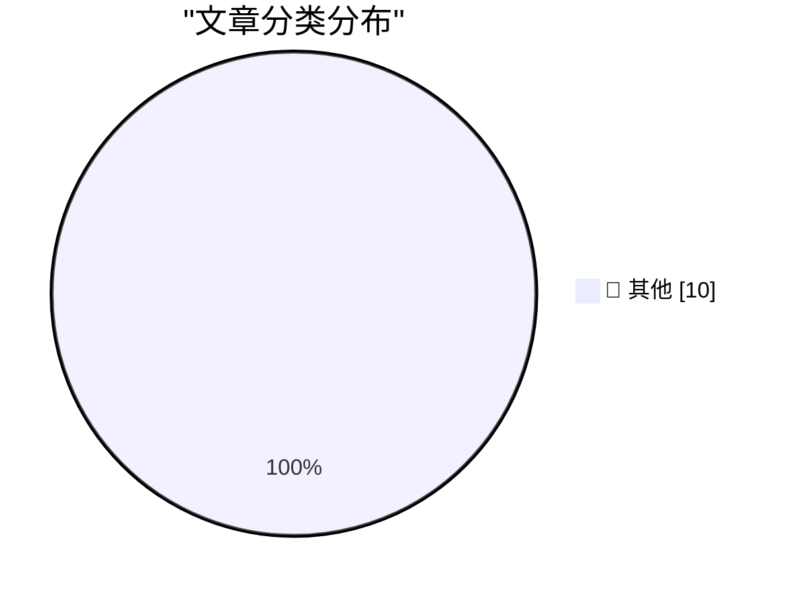

# 📰 AI 博客每日精选 — 2026-11-09

> 来自 Karpathy 推荐的 92 个顶级技术博客，AI 精选 Top 10

## 🏆 今日必读

🥇 **parse_number() as a SQLite extension: C vs Rust**

[parse_number() as a SQLite extension: C vs Rust](https://simonwillison.net/2026/Nov/8/sqlite-parse-number-c-vs-rust/) — simonwillison.net · 36 分钟前 · 📝 其他

> Simon Willison’s Weblog Newsletter 8th November 2026 Research parse_number() as a SQLite extension: C vs Rust &mdash; Four SQLite extensions implement the same `parse_number()` behavior in C and Rust,

🥈 **Reverse engineering a vintage diode-transistor logic chip**

[Reverse engineering a vintage diode-transistor logic chip](http://www.righto.com/feeds/7533579802505281921/comments/default) — righto.com · 6 小时前 · 📝 其他

> tag:blogger.com,1999:blog-6264947694886887540.post7533579802505281921..comments 2026-11-08T12:45:17.653-08:00 Comments on Ken Shirriff's blog: Reverse engineering a vintage diode-transistor logic chip

🥉 **Some thoughts on restaurant menu QR codes**

[Some thoughts on restaurant menu QR codes](https://shkspr.mobi/blog/2026/11/some-thoughts-on-restaurant-menu-qr-codes/) — shkspr.mobi · 10 小时前 · 📝 其他

> Some thoughts on restaurant menu QR codes future NaBloPoMo QR Codes restaurant · 8 comments · 600 words · Viewed ~788 times 10.59350/mgnde-vgr48 Is anyone else SICK AND TIRED of the way hotels now foi

---

## 📊 数据概览

| 扫描源 | 抓取文章 | 时间范围 | 精选 |
|:---:|:---:|:---:|:---:|
| 77/92 | 2323 篇 → 10 篇 | 24h | **10 篇** |

### 分类分布

---

## 📝 其他

### 1. parse_number() as a SQLite extension: C vs Rust

[parse_number() as a SQLite extension: C vs Rust](https://simonwillison.net/2026/Nov/8/sqlite-parse-number-c-vs-rust/) — **simonwillison.net** · 36 分钟前 · ⭐ 15/30

> Simon Willison’s Weblog Newsletter 8th November 2026 Research parse_number() as a SQLite extension: C vs Rust &mdash; Four SQLite extensions implement the same `parse_number()` behavior in C and Rust,

---

### 2. Reverse engineering a vintage diode-transistor logic chip

[Reverse engineering a vintage diode-transistor logic chip](http://www.righto.com/feeds/7533579802505281921/comments/default) — **righto.com** · 6 小时前 · ⭐ 15/30

> tag:blogger.com,1999:blog-6264947694886887540.post7533579802505281921..comments 2026-11-08T12:45:17.653-08:00 Comments on Ken Shirriff's blog: Reverse engineering a vintage diode-transistor logic chip

---

### 3. Some thoughts on restaurant menu QR codes

[Some thoughts on restaurant menu QR codes](https://shkspr.mobi/blog/2026/11/some-thoughts-on-restaurant-menu-qr-codes/) — **shkspr.mobi** · 10 小时前 · ⭐ 15/30

> Some thoughts on restaurant menu QR codes future NaBloPoMo QR Codes restaurant · 8 comments · 600 words · Viewed ~788 times 10.59350/mgnde-vgr48 Is anyone else SICK AND TIRED of the way hotels now foi

---

### 4. The problem with Micron MT 4264 RAM

[The problem with Micron MT 4264 RAM](https://dfarq.homeip.net/the-problem-with-micron-mt-4264-ram/?utm_source=rss&#038;utm_medium=rss&#038;utm_campaign=the-problem-with-micron-mt-4264-ram) — **dfarq.homeip.net** · 11 小时前 · ⭐ 15/30

> Watch a Youtube video about repairing a 1980s 8-bit computer, and you can flip a coin about whether the problem will be the presence of MT (Micron) 4264 RAM chips inside. MT RAM chips of mid 1980s vin

---

### 5. Is AI crashing?

[Is AI crashing?](https://dfarq.homeip.net/is-ai-crashing/?utm_source=rss&#038;utm_medium=rss&#038;utm_campaign=is-ai-crashing) — **dfarq.homeip.net** · 11 小时前 · ⭐ 15/30

> It’s November 8, 2027. I don’t know if AI is crashing. I don’t know if the AI bubble has burst. Not yet. Some people say it is. I remember the dotcom crash but didn’t blog about it, regrettably. Writi

---

### 6. LLMs are terrible at designing AI systems

[LLMs are terrible at designing AI systems](https://seangoedecke.com/llms-are-terrible-at-designing-ai-systems/) — **seangoedecke.com** · 23 小时前 · ⭐ 15/30

> LLMs don’t know how to design software that uses LLMs. They’re comfortable writing normal programs, but if you throw an AI-shaped problem at them, they will usually screw it up. Why is that? Going dow

---

### 7. The great software IP writedown

[The great software IP writedown](https://martinalderson.com/posts/the-great-software-ip-writedown/?utm_source=rss&amp;utm_medium=rss&amp;utm_campaign=feed) — **martinalderson.com** · 23 小时前 · ⭐ 15/30

> Around a year ago I asked whether the cost of building software had just dropped 90% . A lot has happened since then, and I've become more interested in the knock-on question: if building software is 

---

### 8. datasette #3046: Don't serve link: rel=next HTTP headers to Firefox for HTML pages

[datasette #3046: Don't serve link: rel=next HTTP headers to Firefox for HTML pages](https://simonwillison.net/2026/Nov/7/link-rel-next/) — **simonwillison.net** · 23 小时前 · ⭐ 15/30

> Simon Willison’s Weblog Newsletter 7th November 2026 - Link Blog datasette #3046: Don't serve link: rel=next HTTP headers to Firefox for HTML pages . I was looking at the Firefox network panel today w

---

### 9. OurCal

[OurCal](https://ourcal.com/?utm_source=daringfireball&amp;utm_medium=sponsorship&amp;utm_content=post-thankyou) — **daringfireball.net** · 1 小时前 · ⭐ 15/30

> 4.7 ★ 2,539 ratings · Trusted by 100,000+ groups 4.7 ★ 2,539 ratings Trusted by 100,000+ groups Shared calendar. Meet messenger. The shared calendar built around messaging. Group calendars for familie

---

### 10. Nvidia CEO Jensen Huang Was Banging a Chinese Spy, Who Was Feeding Information Back to Beijing

[Nvidia CEO Jensen Huang Was Banging a Chinese Spy, Who Was Feeding Information Back to Beijing](https://www.nytimes.com/2026/11/08/technology/nvidia-investigation-jensen-huang-china.html?unlocked_article_code=1.O1E.Soow.6UjrM7Ch-C8L) — **daringfireball.net** · 1 小时前 · ⭐ 15/30

> Tripp Mickle, reporting for The New York Times: Nvidia said on Sunday that it was opening an investigation into Jensen Huang, its chief executive and co-founder, after he acknowledged to the company’s

---

*生成于 2026-11-09 07:02 | 扫描 77 源 → 获取 2323 篇 → 精选 10 篇*
*基于 [Hacker News Popularity Contest 2025](https://refactoringenglish.com/tools/hn-popularity/) RSS 源列表*
