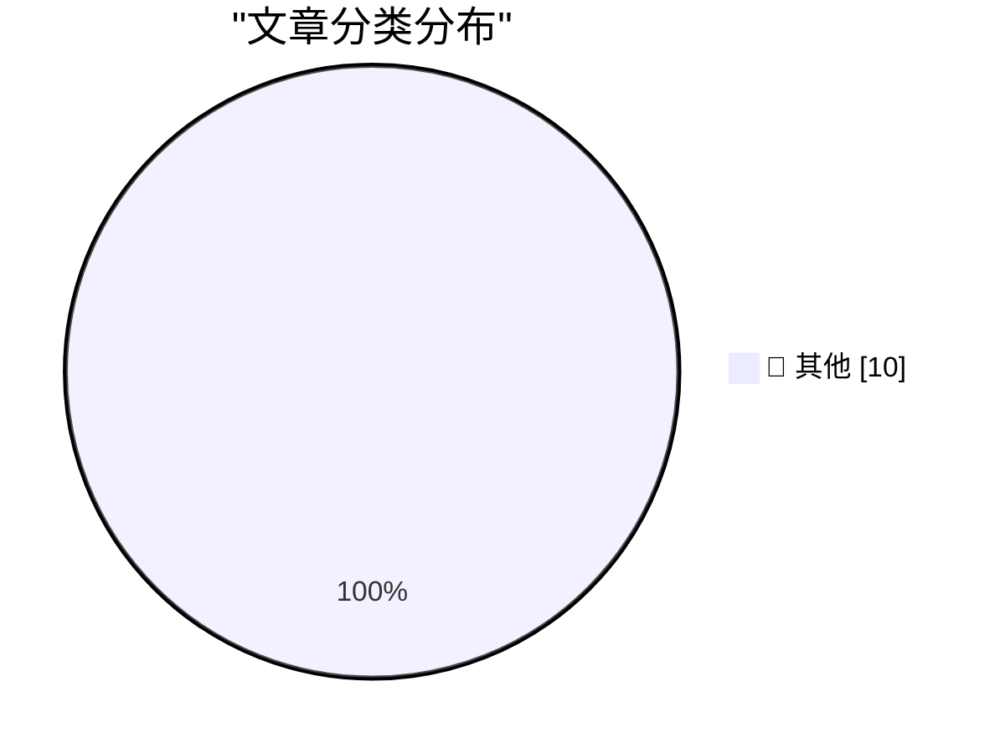

# 📰 AI 博客每日精选 — 2026-11-10

> 来自 Karpathy 推荐的 92 个顶级技术博客，AI 精选 Top 10

## 🏆 今日必读

🥇 **Steiner Systems**

[Steiner Systems](https://www.johndcook.com/blog/2026/11/09/steiner-systems/) — johndcook.com · 6 小时前 · 📝 其他

> Steiner triples Several examples from the recent posts on finite geometry are special cases of Steiner triples. A Steiner triple system, written STS( n ), is a set S of n elements and a collection of 

🥈 **Finite hyperbolic planes**

[Finite hyperbolic planes](https://www.johndcook.com/blog/2026/11/09/finite-hyperbolic-planes/) — johndcook.com · 8 小时前 · 📝 其他

> Euclid’s fifth postulate says that given a line ℓ and a point P not on ℓ , there is a unique line through P parallel to ℓ. In the projective plane there are no parallel lines, and in the hyperbolic pl

🥉 **Blunt Banhammer Blocks Basic Bots Ballistically**

[Blunt Banhammer Blocks Basic Bots Ballistically](https://shkspr.mobi/blog/2026/11/blunt-banhammer-blocks-basic-bots-ballistically/) — shkspr.mobi · 10 小时前 · 📝 其他

> Blunt Banhammer Blocks Basic Bots Ballistically AI bot CyberSecurity NaBloPoMo PHP WebDev · 17 comments · 1,350 words · Viewed ~1,576 times 10.59350/bwbef-dkh55 I cut bot traffic to my site by over 80

---

## 📊 数据概览

| 扫描源 | 抓取文章 | 时间范围 | 精选 |
|:---:|:---:|:---:|:---:|
| 77/92 | 2323 篇 → 18 篇 | 24h | **10 篇** |

### 分类分布

---

## 📝 其他

### 1. Steiner Systems

[Steiner Systems](https://www.johndcook.com/blog/2026/11/09/steiner-systems/) — **johndcook.com** · 6 小时前 · ⭐ 15/30

> Steiner triples Several examples from the recent posts on finite geometry are special cases of Steiner triples. A Steiner triple system, written STS( n ), is a set S of n elements and a collection of 

---

### 2. Finite hyperbolic planes

[Finite hyperbolic planes](https://www.johndcook.com/blog/2026/11/09/finite-hyperbolic-planes/) — **johndcook.com** · 8 小时前 · ⭐ 15/30

> Euclid’s fifth postulate says that given a line ℓ and a point P not on ℓ , there is a unique line through P parallel to ℓ. In the projective plane there are no parallel lines, and in the hyperbolic pl

---

### 3. Blunt Banhammer Blocks Basic Bots Ballistically

[Blunt Banhammer Blocks Basic Bots Ballistically](https://shkspr.mobi/blog/2026/11/blunt-banhammer-blocks-basic-bots-ballistically/) — **shkspr.mobi** · 10 小时前 · ⭐ 15/30

> Blunt Banhammer Blocks Basic Bots Ballistically AI bot CyberSecurity NaBloPoMo PHP WebDev · 17 comments · 1,350 words · Viewed ~1,576 times 10.59350/bwbef-dkh55 I cut bot traffic to my site by over 80

---

### 4. Radio Shack index

[Radio Shack index](https://dfarq.homeip.net/radio-shack-index/?utm_source=rss&#038;utm_medium=rss&#038;utm_campaign=radio-shack-index) — **dfarq.homeip.net** · 10 小时前 · ⭐ 15/30

> Radio Shack billed itself as “The Technology Store.” And at one time it was a consumer electronics giant. At its peak, it had more than 5,000 locations strategically placed so that a ridiculously high

---

### 5. Silicon Graphics founded November 9, 1981

[Silicon Graphics founded November 9, 1981](https://dfarq.homeip.net/silicon-graphics-founded-november-9-1981/?utm_source=rss&#038;utm_medium=rss&#038;utm_campaign=silicon-graphics-founded-november-9-1981) — **dfarq.homeip.net** · 11 小时前 · ⭐ 15/30

> Silicon Graphics was a legendary maker of Unix workstations, founded November 9, 1981. Its Indy and O2 workstations, powered by MIPS RISC microprocessors and SGI’s fabled IRIX operating system, are am

---

### 6. Introducing Ninety

[Introducing Ninety](https://nesbitt.io/2026/11/09/introducing-ninety.html) — **nesbitt.io** · 11 小时前 · ⭐ 15/30

> We’re excited to announce Ninety, the first prediction market for open source security, launching today in partnership with Lanternfish, the frontier AI lab for software security. Security report volu

---

### 7. Pluralistic: America cannot undo Trumpism (09 Nov 2026)

[Pluralistic: America cannot undo Trumpism (09 Nov 2026)](https://pluralistic.net/2026/11/09/brunch-is-canceled-forever/) — **pluralistic.net** · 15 小时前 · ⭐ 15/30

> ->->->->->->->->->->->->->->->->->->->->->->->->->->->->-> Top Sources: None --> Today's links America cannot undo Trumpism : The only way out is through. Hey look at this : Delights to delectate. Obj

---

### 8. The Web Is More Than Enough, by Paul Ford

[The Web Is More Than Enough, by Paul Ford](https://simonwillison.net/2026/Nov/9/hn-50421091/) — **simonwillison.net** · 18 小时前 · ⭐ 15/30

> Simon Willison’s Weblog Newsletter Sponsored by: doubleAI &mdash; doubleAI’s Maxwell makes software faster as it runs, no code changes needed. Now in early access 9th November 2026 Comment My comment 

---

### 9. Hide your slop PR descriptions behind

[Hide your slop PR descriptions behind](https://simonwillison.net/2026/Nov/9/details-summary/) — **simonwillison.net** · 18 小时前 · ⭐ 15/30

> Simon Willison’s Weblog Newsletter Sponsored by: doubleAI &mdash; doubleAI’s Maxwell makes software faster as it runs, no code changes needed. Now in early access Hide your slop PR descriptions behind

---

### 10. Yak-Shaving Overload

[Yak-Shaving Overload](https://feed.tedium.co/link/15204/17518143/yak-shaving-ai-mental-health-effects) — **tedium.co** · 20 小时前 · ⭐ 15/30

> Yak-Shaving Overload Over the years I’ve gotten myself into all varieties of technical rabbit holes and wild goose chases. But I’m feeling weird about my latest trip, involving a forgotten Linux table

---

*生成于 2026-11-10 07:20 | 扫描 77 源 → 获取 2323 篇 → 精选 10 篇*
*基于 [Hacker News Popularity Contest 2025](https://refactoringenglish.com/tools/hn-popularity/) RSS 源列表*
