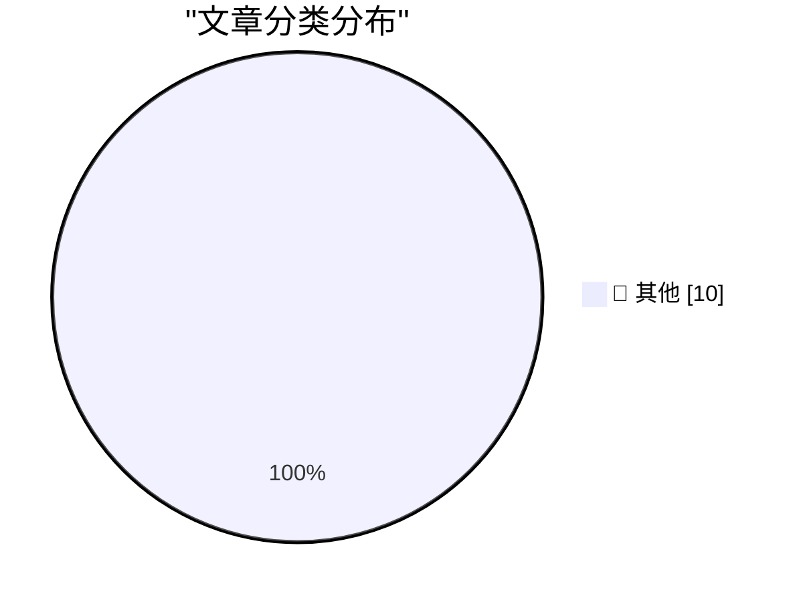

# 📰 AI 博客每日精选 — 2026-11-15

> 来自 Karpathy 推荐的 92 个顶级技术博客，AI 精选 Top 10

## 🏆 今日必读

🥇 **Ops needs friction**

[Ops needs friction](https://www.jeffgeerling.com/blog/2026/ops-needs-friction/) — jeffgeerling.com · 6 小时前 · 📝 其他

> Ops needs friction Nov 14, 2026 Between Microsoft's two-day outage and the FAA ground stop yesterday , there's plenty of ink spilled about who's responsible, why these things happened, etc. But it mad

🥈 **Reading List 11/14/2026**

[Reading List 11/14/2026](https://www.construction-physics.com/p/reading-list-11142026) — construction-physics.com · 7 小时前 · 📝 其他

> The Shepherd’s Dream from “Paradise Lost,” by Henry Fuseli, via WikiArt . Welcome to the reading list, a weekly roundup of news and links related to buildings, infrastructure, and industrial technolog

🥉 **The longest polynomial level set**

[The longest polynomial level set](https://www.johndcook.com/blog/2026/11/14/erdos-lemniscate/) — johndcook.com · 7 小时前 · 📝 其他

> Let p ( z ) be a polynomial with leading coefficient 1, i.e. a monic polynomial. What is the maximum length of the curve { z : | p ( z )| = 1} for each degree n? Erdős conjectured that the maximum len

---

## 📊 数据概览

| 扫描源 | 抓取文章 | 时间范围 | 精选 |
|:---:|:---:|:---:|:---:|
| 76/92 | 2313 篇 → 13 篇 | 24h | **10 篇** |

### 分类分布

---

## 📝 其他

### 1. Ops needs friction

[Ops needs friction](https://www.jeffgeerling.com/blog/2026/ops-needs-friction/) — **jeffgeerling.com** · 6 小时前 · ⭐ 15/30

> Ops needs friction Nov 14, 2026 Between Microsoft's two-day outage and the FAA ground stop yesterday , there's plenty of ink spilled about who's responsible, why these things happened, etc. But it mad

---

### 2. Reading List 11/14/2026

[Reading List 11/14/2026](https://www.construction-physics.com/p/reading-list-11142026) — **construction-physics.com** · 7 小时前 · ⭐ 15/30

> The Shepherd’s Dream from “Paradise Lost,” by Henry Fuseli, via WikiArt . Welcome to the reading list, a weekly roundup of news and links related to buildings, infrastructure, and industrial technolog

---

### 3. The longest polynomial level set

[The longest polynomial level set](https://www.johndcook.com/blog/2026/11/14/erdos-lemniscate/) — **johndcook.com** · 7 小时前 · ⭐ 15/30

> Let p ( z ) be a polynomial with leading coefficient 1, i.e. a monic polynomial. What is the maximum length of the curve { z : | p ( z )| = 1} for each degree n? Erdős conjectured that the maximum len

---

### 4. Peeking inside the bash rabbit hole

[Peeking inside the bash rabbit hole](https://www.johndcook.com/blog/2026/11/14/bash-rabbit-hole/) — **johndcook.com** · 10 小时前 · ⭐ 15/30

> I have much bigger issues to be concerned with than saving a few seconds of typing with obscure bash features. But precisely because I have bigger issues on my plate, it’s fun to take a moment and sol

---

### 5. Theatre Review: FrankenTacit ★★☆☆☆

[Theatre Review: FrankenTacit ★★☆☆☆](https://shkspr.mobi/blog/2026/11/theatre-review-frankentacit/) — **shkspr.mobi** · 10 小时前 · ⭐ 15/30

> Theatre Review: FrankenTacit ★★☆☆☆ gig NaBloPoMo Theatre Review · 750 words · Viewed ~324 times 10.59350/rwvyh-t2g26 Is Frankenstein the first cautionary tale about AI? If so, what does it mean to re-

---

### 6. Vintage computer power centers

[Vintage computer power centers](https://dfarq.homeip.net/vintage-computer-power-centers/?utm_source=rss&#038;utm_medium=rss&#038;utm_campaign=vintage-computer-power-centers) — **dfarq.homeip.net** · 11 小时前 · ⭐ 15/30

> Power centers were and unassuming computer accessory from bygone decades, but they helped to solve a real problem. And they are one of the very few vintage computer items you can still find routinely 

---

### 7. This Week in Package Management: 14 November 2026

[This Week in Package Management: 14 November 2026](https://nesbitt.io/2026/11/14/this-week-in-package-management.html) — **nesbitt.io** · 13 小时前 · ⭐ 15/30

> This week’s package management news, gathered from the package manager OPML feed collection , my posts and boosts on Mastodon , and anything people sent me. Version control and forge news is in the We

---

### 8. How to find meaning in large tech companies

[How to find meaning in large tech companies](https://seangoedecke.com/how-to-find-meaning-in-large-tech-companies/) — **seangoedecke.com** · 23 小时前 · ⭐ 15/30

> Why do many people hate working in large tech companies? The obvious answer is “because organizational dysfunction stops them from doing the things they want to do”. Engineers like to write code and s

---

### 9. Of Course People Hate Data Centres

[Of Course People Hate Data Centres](https://hugotunius.se/2026/11/14/of-course-people-hate-data-centres.html) — **hugotunius.se** · 23 小时前 · ⭐ 15/30

> The breakout issue of 2026 has undoubtedly been data centres, more precisely opposition to data centres. People despise them. In the US midterms, only a single ballot measure (out of 44) on data centr

---

### 10. Joanna Stern Reviews the HomeView

[Joanna Stern Reviews the HomeView](https://www.youtube.com/watch?v=yVTcVtLn2o4) — **daringfireball.net** · 5 小时前 · ⭐ 15/30

> This is so goddamn good. Both informative and hilarious. (She made a fun bonus reel that’s right up my alley too — but watch the main review first.) ★

---

*生成于 2026-11-15 07:27 | 扫描 76 源 → 获取 2313 篇 → 精选 10 篇*
*基于 [Hacker News Popularity Contest 2025](https://refactoringenglish.com/tools/hn-popularity/) RSS 源列表*
