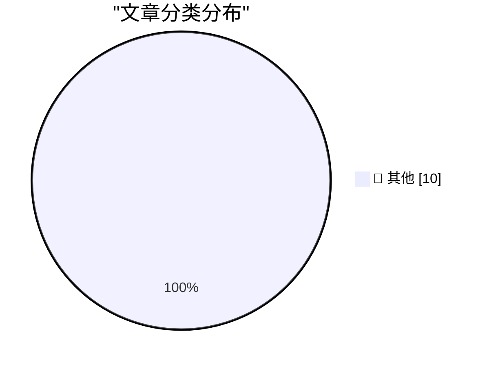

# 📰 AI 博客每日精选 — 2026-11-17

> 来自 Karpathy 推荐的 92 个顶级技术博客，AI 精选 Top 10

## 🏆 今日必读

🥇 **Here's how anyone can easily use private, open weight models**

[Here's how anyone can easily use private, open weight models](https://micahflee.com/heres-how-anyone-can-easily-use-private-open-weight-models/) — micahflee.com · 6 小时前 · 📝 其他

> 16 Nov 2026 6 min read Here's how anyone can easily use private, open weight models Share Micah Lee I prompted DeepSeek Uncensored to research tools related to the Icepick dataset , a leak of info abo

🥈 **Taxis and hash functions**

[Taxis and hash functions](https://www.johndcook.com/blog/2026/11/16/taxis-and-hash-functions/) — johndcook.com · 8 小时前 · 📝 其他

> In 2014 New York City released dump of trip and fare logs from NYC taxis in the previous year. In an attempt to protect privacy, the taxi license numbers and medallion numbers were hashed using the MD

🥉 **Gig Review: ABBA Voyage ★★★★☆**

[Gig Review: ABBA Voyage ★★★★☆](https://shkspr.mobi/blog/2026/11/gig-review-abba-voyage/) — shkspr.mobi · 10 小时前 · 📝 其他

> Gig Review: ABBA Voyage ★★★★☆ gig music NaBloPoMo Review · 650 words · Viewed ~420 times 10.59350/mygn9-knn13 During our recent visit to Stockholm, we went to the ABBA museum . Although they're obviou

---

## 📊 数据概览

| 扫描源 | 抓取文章 | 时间范围 | 精选 |
|:---:|:---:|:---:|:---:|
| 75/92 | 2176 篇 → 17 篇 | 24h | **10 篇** |

### 分类分布

---

## 📝 其他

### 1. Here's how anyone can easily use private, open weight models

[Here's how anyone can easily use private, open weight models](https://micahflee.com/heres-how-anyone-can-easily-use-private-open-weight-models/) — **micahflee.com** · 6 小时前 · ⭐ 15/30

> 16 Nov 2026 6 min read Here's how anyone can easily use private, open weight models Share Micah Lee I prompted DeepSeek Uncensored to research tools related to the Icepick dataset , a leak of info abo

---

### 2. Taxis and hash functions

[Taxis and hash functions](https://www.johndcook.com/blog/2026/11/16/taxis-and-hash-functions/) — **johndcook.com** · 8 小时前 · ⭐ 15/30

> In 2014 New York City released dump of trip and fare logs from NYC taxis in the previous year. In an attempt to protect privacy, the taxi license numbers and medallion numbers were hashed using the MD

---

### 3. Gig Review: ABBA Voyage ★★★★☆

[Gig Review: ABBA Voyage ★★★★☆](https://shkspr.mobi/blog/2026/11/gig-review-abba-voyage/) — **shkspr.mobi** · 10 小时前 · ⭐ 15/30

> Gig Review: ABBA Voyage ★★★★☆ gig music NaBloPoMo Review · 650 words · Viewed ~420 times 10.59350/mygn9-knn13 During our recent visit to Stockholm, we went to the ABBA museum . Although they're obviou

---

### 4. The rise and fall of Syquest

[The rise and fall of Syquest](https://dfarq.homeip.net/the-rise-and-fall-of-syquest/?utm_source=rss&#038;utm_medium=rss&#038;utm_campaign=the-rise-and-fall-of-syquest) — **dfarq.homeip.net** · 11 小时前 · ⭐ 15/30

> Syquest was a maker of removable hard drives. It was a clever idea that is completely obsolete in these days of high capacity USB flash drives, but at the time, Syquest drives solved a real problem. F

---

### 5. Weekly Update 530: Email Dependencies & Apps

[Weekly Update 530: Email Dependencies & Apps](https://www.troyhunt.com/weekly-update-530/) — **troyhunt.com** · 15 小时前 · ⭐ 15/30

> Email is just one of those utilities like power or water where you always expect it to just, well, to just be there. You sign up with a provider and use as much of it as you need, when you need it, an

---

### 6. Orbital footnote

[Orbital footnote](https://www.johndcook.com/blog/2026/11/15/orbital-footnote/) — **johndcook.com** · 20 小时前 · ⭐ 15/30

> A couple days ago I wrote a post about the orbit of a new dwarf planet candidate. The article says the newly discovered object, ED138, has an orbital period of 281.1 years and is “46 times farther fro

---

### 7. People will lose their jobs over GTA 6

[People will lose their jobs over GTA 6](https://idiallo.com/blog/losing-your-job-over-a-video-game) — **idiallo.com** · 22 小时前 · ⭐ 15/30

> GTA 6 is about to come out, and I've seen many people online joking that they'll take the week off to play it. I'm not a big fan of GTA, but the series did leave an impression on me. The last one I pl

---

### 8. datasette-maplibre 0.1a0

[datasette-maplibre 0.1a0](https://simonwillison.net/2026/Nov/15/datasette-maplibre/) — **simonwillison.net** · 23 小时前 · ⭐ 15/30

> Simon Willison’s Weblog Newsletter Sponsored by: Dynatrace &mdash; Your coding agent can read your code but can’t see how it runs in production. Read the blog to see how Dynatrace MCP closes that gap.

---

### 9. datasette 1.0a43

[datasette 1.0a43](https://simonwillison.net/2026/Nov/15/datasette/) — **simonwillison.net** · 23 小时前 · ⭐ 15/30

> Simon Willison’s Weblog Newsletter Sponsored by: Dynatrace &mdash; Your coding agent can read your code but can’t see how it runs in production. Read the blog to see how Dynatrace MCP closes that gap.

---

### 10. Irish Goodbye / French Leave / Leave the English Way

[Irish Goodbye / French Leave / Leave the English Way](https://terriblemaps.co.uk/leaving-a-party-without-saying-goodbye/) — **daringfireball.net** · 7 分钟前 · ⭐ 15/30

> In Britain, leaving a party without saying goodbye is taking French leave, in France it’s leaving the English way, and this map shows who everyone else blames for it. How terrible is this map? 1 2 3 4

---

*生成于 2026-11-17 07:03 | 扫描 75 源 → 获取 2176 篇 → 精选 10 篇*
*基于 [Hacker News Popularity Contest 2025](https://refactoringenglish.com/tools/hn-popularity/) RSS 源列表*
