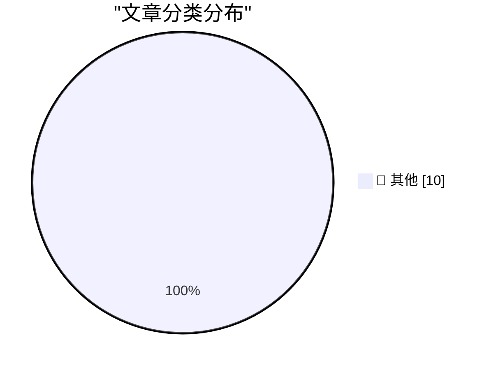

# 📰 AI 博客每日精选 — 2026-11-19

> 来自 Karpathy 推荐的 92 个顶级技术博客，AI 精选 Top 10

## 🏆 今日必读

🥇 **★ The 50-Yard Line**

[★ The 50-Yard Line](https://daringfireball.net/2026/11/the_50-yard_line) — daringfireball.net · 2 小时前 · 📝 其他

> By John Gruber Archive The Talk Show Dithering Projects Contact Colophon Feeds / Social Twitter --> Sponsorship Ivy: Plan. Do. Reflect . The to-do list that ends. The 50-Yard Line Wednesday, 18 Novemb

🥈 **Quoting Daniel Stenberg**

[Quoting Daniel Stenberg](https://simonwillison.net/2026/Nov/18/daniel-stenberg/) — simonwillison.net · 7 小时前 · 📝 其他

> Simon Willison’s Weblog Newsletter Sponsored by: Dynatrace &mdash; Your coding agent can read your code but can’t see how it runs in production. Read the blog to see how Dynatrace MCP closes that gap.

🥉 **The PSF end-of-year fundraiser**

[The PSF end-of-year fundraiser](https://simonwillison.net/2026/Nov/18/psf-end-of-year-fundraiser/) — simonwillison.net · 8 小时前 · 📝 其他

> Simon Willison’s Weblog Newsletter Sponsored by: Dynatrace &mdash; Your coding agent can read your code but can’t see how it runs in production. Read the blog to see how Dynatrace MCP closes that gap.

---

## 📊 数据概览

| 扫描源 | 抓取文章 | 时间范围 | 精选 |
|:---:|:---:|:---:|:---:|
| 78/92 | 2352 篇 → 11 篇 | 24h | **10 篇** |

### 分类分布

---

## 📝 其他

### 1. ★ The 50-Yard Line

[★ The 50-Yard Line](https://daringfireball.net/2026/11/the_50-yard_line) — **daringfireball.net** · 2 小时前 · ⭐ 15/30

> By John Gruber Archive The Talk Show Dithering Projects Contact Colophon Feeds / Social Twitter --> Sponsorship Ivy: Plan. Do. Reflect . The to-do list that ends. The 50-Yard Line Wednesday, 18 Novemb

---

### 2. Quoting Daniel Stenberg

[Quoting Daniel Stenberg](https://simonwillison.net/2026/Nov/18/daniel-stenberg/) — **simonwillison.net** · 7 小时前 · ⭐ 15/30

> Simon Willison’s Weblog Newsletter Sponsored by: Dynatrace &mdash; Your coding agent can read your code but can’t see how it runs in production. Read the blog to see how Dynatrace MCP closes that gap.

---

### 3. The PSF end-of-year fundraiser

[The PSF end-of-year fundraiser](https://simonwillison.net/2026/Nov/18/psf-end-of-year-fundraiser/) — **simonwillison.net** · 8 小时前 · ⭐ 15/30

> Simon Willison’s Weblog Newsletter Sponsored by: Dynatrace &mdash; Your coding agent can read your code but can’t see how it runs in production. Read the blog to see how Dynatrace MCP closes that gap.

---

### 4. Once More Unto The Breach - Another Year In Review

[Once More Unto The Breach - Another Year In Review](https://shkspr.mobi/blog/2026/11/once-more-unto-the-breach-another-year-in-review/) — **shkspr.mobi** · 10 小时前 · ⭐ 15/30

> Once More Unto The Breach - Another Year In Review FIRE meta NaBloPoMo · 3 comments · 800 words · Viewed ~504 times 10.59350/ckwg6-q5j86 Since 2010, I've written an annual "year-in-review" blog post 0

---

### 5. Push button telephones introduced November 18, 1963

[Push button telephones introduced November 18, 1963](https://dfarq.homeip.net/push-button-telephones-introduced-november-18-1963/?utm_source=rss&#038;utm_medium=rss&#038;utm_campaign=push-button-telephones-introduced-november-18-1963) — **dfarq.homeip.net** · 11 小时前 · ⭐ 15/30

> It was 62 years ago, on November 18, 1963, that the push button telephone, or touch tone phone, was first introduced. Before push button phones The Western Electric 2500 (pictured) was the standard-is

---

### 6. This Week in Source Control: 18 November 2026

[This Week in Source Control: 18 November 2026](https://nesbitt.io/2026/11/18/this-week-in-source-control.html) — **nesbitt.io** · 13 小时前 · ⭐ 15/30

> This week’s version control and forge news, gathered from release feeds for source control clients and forges, the Lobsters vcs tag , Hacker News, and my boosts on Mastodon . Package management news i

---

### 7. Pluralistic: Enshittifiers groom us for scammers (18 Nov 2026)

[Pluralistic: Enshittifiers groom us for scammers (18 Nov 2026)](https://pluralistic.net/2026/11/18/malice-v-incompetence/) — **pluralistic.net** · 14 小时前 · ⭐ 15/30

> ->->->->->->->->->->->->->->->->->->->->->->->->->->->->-> Top Sources: None --> Today's links Enshittifiers groom us for scammers : The harder it is to tell a scam from a shitty business practice, th

---

### 8. Attackers Used Optimizely to A/B Test Malware on Top Websites

[Attackers Used Optimizely to A/B Test Malware on Top Websites](https://krebsonsecurity.com/2026/11/attackers-used-optimizely-to-a-b-test-malware-on-top-websites/) — **krebsonsecurity.com** · 20 小时前 · ⭐ 15/30

> At least 178 top web destinations unwittingly served a variety of malware exploits against visitors over the past 24 hours thanks to a security vulnerability involving Optimizely , a company that help

---

### 9. "No way to prevent this" say users of only language where this regularly happens

["No way to prevent this" say users of only language where this regularly happens](https://xeiaso.net/shitposts/no-way-to-prevent-this/memory-safety/CVE-2026-123633/) — **xeiaso.net** · 23 小时前 · ⭐ 15/30

> "No way to prevent this" say users of only language where this regularly happens Published on 2026-11-18 , 245 words, 1 minutes to read A forlorn business man resting his head on a brown wall next to 

---

### 10. Are vibe-coded games making me a substance dualist?

[Are vibe-coded games making me a substance dualist?](https://rakhim.exotext.com/are-vibe-coded-games-making-me-a-substance-dualist) — **rakhim.exotext.com** · 23 小时前 · ⭐ 15/30

> Seeing vibe-coded videogames lately makes me feel weird. The uncanny valley effect isn't "almost real but not quite" which is the case with AI-generated photos and videos. It's "almost human but not q

---

*生成于 2026-11-19 07:09 | 扫描 78 源 → 获取 2352 篇 → 精选 10 篇*
*基于 [Hacker News Popularity Contest 2025](https://refactoringenglish.com/tools/hn-popularity/) RSS 源列表*
