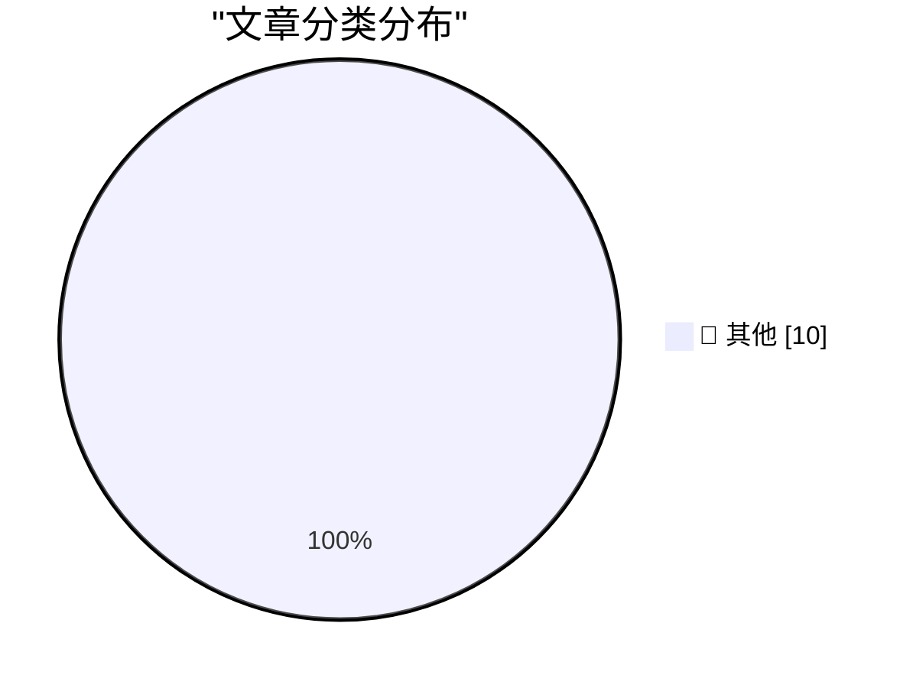

# 📰 AI 博客每日精选 — 2026-11-24

> 来自 Karpathy 推荐的 92 个顶级技术博客，AI 精选 Top 10

## 🏆 今日必读

🥇 **Ladybird's first alpha release**

[Ladybird's first alpha release](https://simonwillison.net/2026/Nov/23/ladybird/) — simonwillison.net · 1 小时前 · 📝 其他

> Simon Willison’s Weblog Newsletter Sponsored by: WorkOS &mdash; Auth.md: signup built for agents. See how it works Ladybird’s first alpha release 23rd November 2026 Ladybird is an astonishingly ambiti

🥈 **Two generators suffice**

[Two generators suffice](https://www.johndcook.com/blog/2026/11/23/two-generators-suffice/) — johndcook.com · 5 小时前 · 📝 其他

> Every finite simple group is generated by at most two elements. This is a consequence of the classification of finite simple groups (CFSG). Not only that, with high probability any two elements chosen

🥉 **Pluralistic: The Debt Trap (23 Nov 2026)**

[Pluralistic: The Debt Trap (23 Nov 2026)](https://pluralistic.net/2026/11/23/grasshoppers-v-ants/) — pluralistic.net · 10 小时前 · 📝 其他

> ->->->->->->->->->->->->->->->->->->->->->->->->->->->->-> Top Sources: None --> Today's links The Debt Trap : Obscure causality is the downfall of us all. Hey look at this : Delights to delectate. Ob

---

## 📊 数据概览

| 扫描源 | 抓取文章 | 时间范围 | 精选 |
|:---:|:---:|:---:|:---:|
| 76/92 | 2254 篇 → 18 篇 | 24h | **10 篇** |

### 分类分布

---

## 📝 其他

### 1. Ladybird's first alpha release

[Ladybird's first alpha release](https://simonwillison.net/2026/Nov/23/ladybird/) — **simonwillison.net** · 1 小时前 · ⭐ 15/30

> Simon Willison’s Weblog Newsletter Sponsored by: WorkOS &mdash; Auth.md: signup built for agents. See how it works Ladybird’s first alpha release 23rd November 2026 Ladybird is an astonishingly ambiti

---

### 2. Two generators suffice

[Two generators suffice](https://www.johndcook.com/blog/2026/11/23/two-generators-suffice/) — **johndcook.com** · 5 小时前 · ⭐ 15/30

> Every finite simple group is generated by at most two elements. This is a consequence of the classification of finite simple groups (CFSG). Not only that, with high probability any two elements chosen

---

### 3. Pluralistic: The Debt Trap (23 Nov 2026)

[Pluralistic: The Debt Trap (23 Nov 2026)](https://pluralistic.net/2026/11/23/grasshoppers-v-ants/) — **pluralistic.net** · 10 小时前 · ⭐ 15/30

> ->->->->->->->->->->->->->->->->->->->->->->->->->->->->-> Top Sources: None --> Today's links The Debt Trap : Obscure causality is the downfall of us all. Hey look at this : Delights to delectate. Ob

---

### 4. Gadget Review: Cheap Zigbee Environmental Sensors ★★★☆☆

[Gadget Review: Cheap Zigbee Environmental Sensors ★★★☆☆](https://shkspr.mobi/blog/2026/11/gadget-review-cheap-zigbee-environmental-sensors/) — **shkspr.mobi** · 10 小时前 · ⭐ 15/30

> Gadget Review: Cheap Zigbee Environmental Sensors ★★★☆☆ HomeAssistant Internet Of Things IoT NaBloPoMo zigbee · 2 comments · 650 words · Viewed ~652 times 10.59350/9rw4n-mdf51 I recently read a great 

---

### 5. Why the Atari Jaguar is so expensive

[Why the Atari Jaguar is so expensive](https://dfarq.homeip.net/why-the-atari-jaguar-is-so-expensive/?utm_source=rss&#038;utm_medium=rss&#038;utm_campaign=why-the-atari-jaguar-is-so-expensive) — **dfarq.homeip.net** · 11 小时前 · ⭐ 15/30

> Atari’s final game console of the 20th century was a console called the Jaguar. It entered a crowded game console market when it was released in late 1993, and it left the market in 1996 with more of 

---

### 6. Gravity on an oblate planet

[Gravity on an oblate planet](https://www.johndcook.com/blog/2026/11/23/oblate-spheroid-gravity/) — **johndcook.com** · 13 小时前 · ⭐ 15/30

> A spherical planet is not a point mass, but the gravity on the surface is the same as if the mass were concentrated at a point in the center. If a planet is not spherical but rather an oblate spheroid

---

### 7. Here's Why Data Breach Disclosure is so Hard: Lessons from Hundreds of Emails with Hacked Companies

[Here's Why Data Breach Disclosure is so Hard: Lessons from Hundreds of Emails with Hacked Companies](https://www.troyhunt.com/heres-why-data-breach-disclosure-is-so-hard-lessons-from-hundreds-of-emails-with-hacked-companies/) — **troyhunt.com** · 15 小时前 · ⭐ 15/30

> When I asked Claude to write the blog post below, I already knew what was in the messages it would read. Hundreds of emails back and forth with companies that had had data breaches, and some very comm

---

### 8. Zenith Data Systems, Part II

[Zenith Data Systems, Part II](https://www.abortretry.fail/p/zenith-data-systems-part-ii) — **abortretry.fail** · 21 小时前 · ⭐ 15/30

> Abort Retry Fail Subscribe Sign in Zenith Data Systems, Part II Pioneering while struggling to survive Nov 23, 2026 ∙ Paid 3 1 1 Share This post is for paid subscribers Subscribe Already a paid subscr

---

### 9. datasette-charts 0.1a0

[datasette-charts 0.1a0](https://simonwillison.net/2026/Nov/23/datasette-charts/) — **simonwillison.net** · 22 小时前 · ⭐ 15/30

> Simon Willison’s Weblog Newsletter Sponsored by: WorkOS &mdash; Auth.md: signup built for agents. See how it works 23rd November 2026 Release datasette-charts 0.1a0 &mdash; A charting plugin for Datas

---

### 10. When in doubt, flail about

[When in doubt, flail about](https://seangoedecke.com/when-in-doubt-flail-about/) — **seangoedecke.com** · 23 小时前 · ⭐ 15/30

> When you’re working in an unclear situation — you have no clear guidance, or you don’t know what will help — the best course of action is often just to flail about. This sounds counter-intuitive. Woul

---

*生成于 2026-11-24 07:25 | 扫描 76 源 → 获取 2254 篇 → 精选 10 篇*
*基于 [Hacker News Popularity Contest 2025](https://refactoringenglish.com/tools/hn-popularity/) RSS 源列表*
