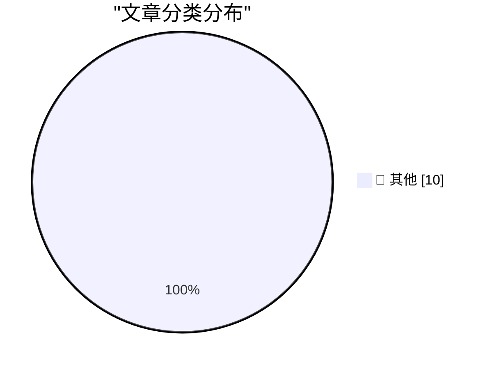

# 📰 AI 博客每日精选 — 2026-11-25

> 来自 Karpathy 推荐的 92 个顶级技术博客，AI 精选 Top 10

## 🏆 今日必读

🥇 **Advent of Microarchitecture 2026**

[Advent of Microarchitecture 2026](http://xania.org/202611/advent-of-what?utm_source=feed&amp;utm_medium=rss) — xania.org · 3 小时前 · 📝 其他

> Matt Godbolt's blog Menu Tags AI Amusing Stuff AoCO2025 AoM2026 Blog Coding Compiler Explorer Emulation Games Microarchitecture New Zealand Trip Personal Python Rants Rust WeeBox Project Archive AI Am

🥈 **Defective Accelerationism**

[Defective Accelerationism](https://www.wheresyoured.at/defective-accelerationism/) — wheresyoured.at · 4 小时前 · 📝 其他

> Defective Accelerationism Ed Zitron Nov 24, 2026 14 min read Table of Contents As discussed , I’m currently taking a week off the podcast and both the free and the premium newsletter to rest, or I was

🥉 **Everything I know about writing**

[Everything I know about writing](https://www.experimental-history.com/p/everything-i-know-about-writing) — experimental-history.com · 5 小时前 · 📝 其他

> photo cred: my dad 1. A few years ago, some researchers put ants and humans in a head-to-head battle of wits. The task was to maneuver an awkwardly sized object through a series of obstacles, like thi

---

## 📊 数据概览

| 扫描源 | 抓取文章 | 时间范围 | 精选 |
|:---:|:---:|:---:|:---:|
| 76/92 | 2259 篇 → 26 篇 | 24h | **10 篇** |

### 分类分布

---

## 📝 其他

### 1. Advent of Microarchitecture 2026

[Advent of Microarchitecture 2026](http://xania.org/202611/advent-of-what?utm_source=feed&amp;utm_medium=rss) — **xania.org** · 3 小时前 · ⭐ 15/30

> Matt Godbolt's blog Menu Tags AI Amusing Stuff AoCO2025 AoM2026 Blog Coding Compiler Explorer Emulation Games Microarchitecture New Zealand Trip Personal Python Rants Rust WeeBox Project Archive AI Am

---

### 2. Defective Accelerationism

[Defective Accelerationism](https://www.wheresyoured.at/defective-accelerationism/) — **wheresyoured.at** · 4 小时前 · ⭐ 15/30

> Defective Accelerationism Ed Zitron Nov 24, 2026 14 min read Table of Contents As discussed , I’m currently taking a week off the podcast and both the free and the premium newsletter to rest, or I was

---

### 3. Everything I know about writing

[Everything I know about writing](https://www.experimental-history.com/p/everything-i-know-about-writing) — **experimental-history.com** · 5 小时前 · ⭐ 15/30

> photo cred: my dad 1. A few years ago, some researchers put ants and humans in a head-to-head battle of wits. The task was to maneuver an awkwardly sized object through a series of obstacles, like thi

---

### 4. GPT 6.2 Astra Solves a Historical Mystery

[GPT 6.2 Astra Solves a Historical Mystery](https://simonwillison.net/2026/Nov/24/astra-historical-mystery/) — **simonwillison.net** · 6 小时前 · ⭐ 15/30

> Simon Willison’s Weblog Newsletter Sponsored by: WorkOS &mdash; Auth.md: signup built for agents. See how it works 24th November 2026 - Link Blog GPT 6.2 Astra Solves a Historical Mystery . Here's an 

---

### 5. Taking a password joke seriously

[Taking a password joke seriously](https://www.johndcook.com/blog/2026/11/24/password-joke/) — **johndcook.com** · 7 小时前 · ⭐ 15/30

> “I’m sorry but your password must contain 1 char each from: Arabic, Chinese, Thai, Korean, Klingon, Wingdings and an emoji” This was a message from Finley Creative (@FinleyCreative) to Jeff Atwood (@c

---

### 6. When happens to entries in the CoreApplication Properties when the source apartment shuts down?

[When happens to entries in the CoreApplication Properties when the source apartment shuts down?](https://devblogs.microsoft.com/oldnewthing/20261124-00/?p=112889/) — **devblogs.microsoft.com/oldnewthing** · 8 小时前 · ⭐ 15/30

> Commenter Luca Bacci observed : Don’t know why, but last I tried the COM static store (runtime class “Windows.ApplicationModel.Core.CoreApplication”) was accessible from an unpackaged, Win32 applicati

---

### 7. Memorable 12-digit primes

[Memorable 12-digit primes](https://www.johndcook.com/blog/2026/11/24/memorable-12-digit-primes/) — **johndcook.com** · 8 小时前 · ⭐ 15/30

> There’s an old joke about having to enter a 12-digit prime number to continue using a program. I wrote about this years ago , on how to use Python to come up with a 12-digit prime. But suppose you do 

---

### 8. How to install an app on your Commodore 64

[How to install an app on your Commodore 64](https://anildash.com/2026/10/08/install-an-app-commodore-64/) — **anildash.com** · 8 小时前 · ⭐ 15/30

> How to install an app on your Commodore 64 24 Nov 2026 2026-11-24 2026-11-24 /images/c64/c64-keyboard.jpg culture, tech, history, retro culture tech history retro 2026 It’s time to install an app! But

---

### 9. NYC’s venture capitalists need to love themselves

[NYC’s venture capitalists need to love themselves](https://anildash.com/2026/11/03/nyc-venture-capitalists-love-themselves/) — **anildash.com** · 8 小时前 · ⭐ 15/30

> NYC’s venture capitalists need to love themselves 24 Nov 2026 2026-11-24 2026-11-24 /images/chinatown-skyline.jpg nyc, venture-capital, silicon-valley, zohran-mamdani nyc venture-capital silicon-valle

---

### 10. Virgin Media Hub 5 API

[Virgin Media Hub 5 API](https://shkspr.mobi/blog/2026/11/virgin-media-hub-5-api/) — **shkspr.mobi** · 10 小时前 · ⭐ 15/30

> Virgin Media Hub 5 API API NaBloPoMo virgin · 1 comment · 1,250 words · Viewed ~532 times 10.59350/59xgq-0w043 I've seen some of these APIs documented around the web, but never in one place. This is a

---

*生成于 2026-11-25 07:02 | 扫描 76 源 → 获取 2259 篇 → 精选 10 篇*
*基于 [Hacker News Popularity Contest 2025](https://refactoringenglish.com/tools/hn-popularity/) RSS 源列表*
