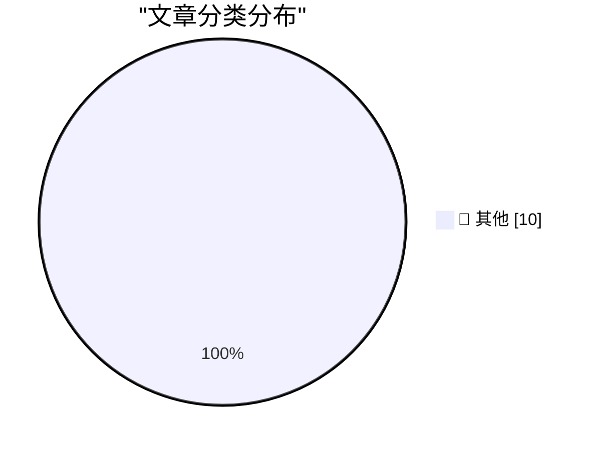

# 📰 AI 博客每日精选 — 2026-11-26

> 来自 Karpathy 推荐的 92 个顶级技术博客，AI 精选 Top 10

## 🏆 今日必读

🥇 **Ansible Fails waiting for privilege escalation on Ubuntu 26**

[Ansible Fails waiting for privilege escalation on Ubuntu 26](https://www.jeffgeerling.com/blog/2026/ansible-fails-become-ubuntu2604/) — jeffgeerling.com · 1 小时前 · 📝 其他

> Ansible Fails waiting for privilege escalation on Ubuntu 26 Nov 25, 2026 I've slowly been moving my servers from Ubuntu 22 and 24 to 26 this year, and noticed my Ansible automation starts failing if I

🥈 **Have You Tried Using Your Agent?**

[Have You Tried Using Your Agent?](https://blog.jim-nielsen.com/2026/have-you-tried-your-agent/) — blog.jim-nielsen.com · 4 小时前 · 📝 其他

> Have You Tried Using Your Agent? Nov 25, 2026 In 2025, I wrote down some thoughts on “AX” . My fear was that AX would end up becoming the top priority for people building software. (I’m not against AX

🥉 **Covering a body with eight smaller copies of itself**

[Covering a body with eight smaller copies of itself](https://www.johndcook.com/blog/2026/11/25/hadwiger-covering/) — johndcook.com · 8 小时前 · 📝 其他

> It’s obvious that you could cover a cube with smaller cubes. You could, for example, take a cube with side 1 and cover it a cube of side ½ centered on each corner. It’s not as obvious how you would co

---

## 📊 数据概览

| 扫描源 | 抓取文章 | 时间范围 | 精选 |
|:---:|:---:|:---:|:---:|
| 77/92 | 2280 篇 → 17 篇 | 24h | **10 篇** |

### 分类分布

---

## 📝 其他

### 1. Ansible Fails waiting for privilege escalation on Ubuntu 26

[Ansible Fails waiting for privilege escalation on Ubuntu 26](https://www.jeffgeerling.com/blog/2026/ansible-fails-become-ubuntu2604/) — **jeffgeerling.com** · 1 小时前 · ⭐ 15/30

> Ansible Fails waiting for privilege escalation on Ubuntu 26 Nov 25, 2026 I've slowly been moving my servers from Ubuntu 22 and 24 to 26 this year, and noticed my Ansible automation starts failing if I

---

### 2. Have You Tried Using Your Agent?

[Have You Tried Using Your Agent?](https://blog.jim-nielsen.com/2026/have-you-tried-your-agent/) — **blog.jim-nielsen.com** · 4 小时前 · ⭐ 15/30

> Have You Tried Using Your Agent? Nov 25, 2026 In 2025, I wrote down some thoughts on “AX” . My fear was that AX would end up becoming the top priority for people building software. (I’m not against AX

---

### 3. Covering a body with eight smaller copies of itself

[Covering a body with eight smaller copies of itself](https://www.johndcook.com/blog/2026/11/25/hadwiger-covering/) — **johndcook.com** · 8 小时前 · ⭐ 15/30

> It’s obvious that you could cover a cube with smaller cubes. You could, for example, take a cube with side 1 and cover it a cube of side ½ centered on each corner. It’s not as obvious how you would co

---

### 4. Polynomials and Planets

[Polynomials and Planets](https://www.johndcook.com/blog/2026/11/25/polynomials-and-planets/) — **johndcook.com** · 9 小时前 · ⭐ 15/30

> A couple days ago I wrote about how the force of gravity varies over the surface of an oblate planet. Earth is slightly oblate, i . e ., it has an equatorial bulge, and this oblateness has a significa

---

### 5. Pluralistic: New York vs auto-enshittification (25 Nov 2026)

[Pluralistic: New York vs auto-enshittification (25 Nov 2026)](https://pluralistic.net/2026/11/25/empire-state-strikes-back/) — **pluralistic.net** · 9 小时前 · ⭐ 15/30

> ->->->->->->->->->->->->->->->->->->->->->->->->->->->->-> Top Sources: None --> Today's links New York vs auto-enshittification : A blueprint for states to fix Congress's mistake. Hey look at this : 

---

### 6. Book Review: Slow Gods by Claire North ★★★★⯪

[Book Review: Slow Gods by Claire North ★★★★⯪](https://shkspr.mobi/blog/2026/11/book-review-slow-gods-by-claire-north/) — **shkspr.mobi** · 10 小时前 · ⭐ 15/30

> Book Review: Slow Gods by Claire North ★★★★⯪ Book Review Claire North NaBloPoMo Sci Fi · 2 comments · 300 words · Viewed ~520 times 10.59350/ngj6a-p9j18 Cor! This is a great big doorstop of a space op

---

### 7. How the Tandy 2000 doomed Tandy computers

[How the Tandy 2000 doomed Tandy computers](https://dfarq.homeip.net/how-the-tandy-2000-doomed-tandy-computers/?utm_source=rss&#038;utm_medium=rss&#038;utm_campaign=how-the-tandy-2000-doomed-tandy-computers) — **dfarq.homeip.net** · 11 小时前 · ⭐ 15/30

> The Tandy 2000 was aptly named. It was twice as good as the Tandy 1000 in nearly every way. But it wasn’t even half as successful. In this blog post, I will explain how the Tandy 2000’s commercial fai

---

### 8. This Week in Source Control: 25 November 2026

[This Week in Source Control: 25 November 2026](https://nesbitt.io/2026/11/25/this-week-in-source-control.html) — **nesbitt.io** · 13 小时前 · ⭐ 15/30

> This week’s version control and forge news, gathered from release feeds for source control clients and forges, the Lobsters vcs tag , Hacker News, and my boosts on Mastodon . Package management news i

---

### 9. Abolish Lock Poisoning

[Abolish Lock Poisoning](https://lucumr.pocoo.org/2026/11/25/poisoning/) — **lucumr.pocoo.org** · 23 小时前 · ⭐ 15/30

> Armin Ronacher 's Thoughts and Writings blog archive projects talks about Abolish Lock Poisoning written on November 25, 2026 Rust has a curious feature that I don’t think the language would land toda

---

### 10. Has Jevons paradox broken down?

[Has Jevons paradox broken down?](https://martinalderson.com/posts/has-jevons-paradox-broken-down/?utm_source=rss&amp;utm_medium=rss&amp;utm_campaign=feed) — **martinalderson.com** · 23 小时前 · ⭐ 15/30

> On a recent YC podcast , Ramp's CEO Eric Glyman claimed that "over the last two months, Jevons paradox broke". Ramp is a corporate card and spend management company, so they see what tens of thousands

---

*生成于 2026-11-26 07:02 | 扫描 77 源 → 获取 2280 篇 → 精选 10 篇*
*基于 [Hacker News Popularity Contest 2025](https://refactoringenglish.com/tools/hn-popularity/) RSS 源列表*
