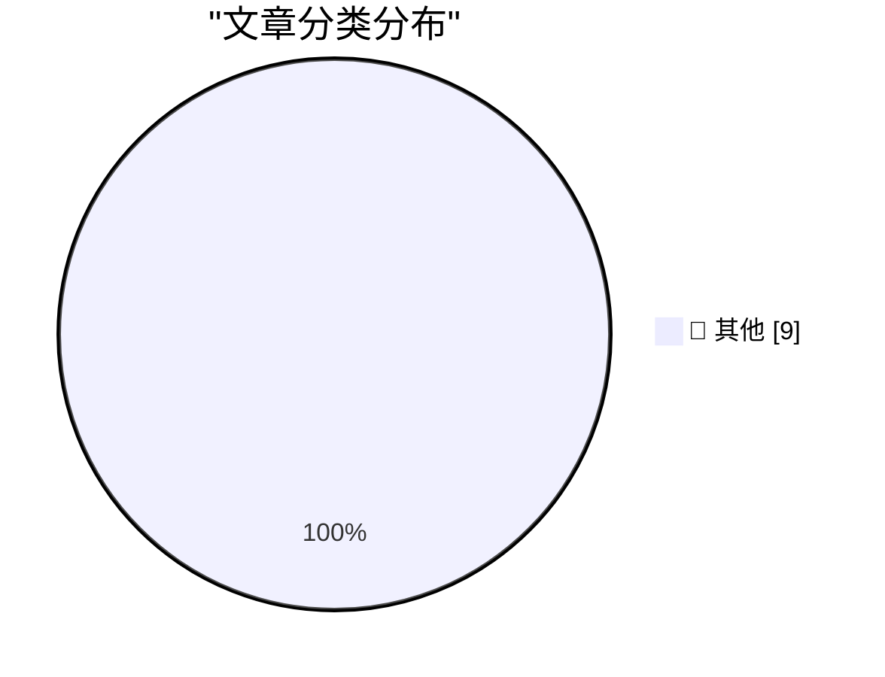

# 📰 AI 博客每日精选 — 2026-11-27

> 来自 Karpathy 推荐的 92 个顶级技术博客，AI 精选 Top 9

## 🏆 今日必读

🥇 **★ Obvious Affordances Are Due for a Comeback**

[★ Obvious Affordances Are Due for a Comeback](https://daringfireball.net/2026/11/obvious_affordances_are_due_for_a_comeback) — daringfireball.net · 8 小时前 · 📝 其他

> By John Gruber Archive The Talk Show Dithering Projects Contact Colophon Feeds / Social Twitter --> Sponsorship Finalist : A very flexible paper-inspired planner. Obvious Affordances Are Due for a Com

🥈 **Quoting Jack Despain Zhou**

[Quoting Jack Despain Zhou](https://simonwillison.net/2026/Nov/26/jack-despain-zhou/) — simonwillison.net · 8 小时前 · 📝 其他

> Simon Willison’s Weblog Newsletter Sponsored by: WorkOS &mdash; Auth.md: signup built for agents. See how it works 26th November 2026 Among the many already existing effects of AI has been a great de-

🥉 **What happens when you put a non-agile object in the CoreApplication Properties?**

[What happens when you put a non-agile object in the CoreApplication Properties?](https://devblogs.microsoft.com/oldnewthing/20261126-00/?p=112899/) — devblogs.microsoft.com/oldnewthing · 8 小时前 · 📝 其他

> Last time, we noticed that non-agile objects in the CoreApplication.Properties appear to behave differently from agile objects . I mean, it looks like they behave differently, but that’s only because 

---

## 📊 数据概览

| 扫描源 | 抓取文章 | 时间范围 | 精选 |
|:---:|:---:|:---:|:---:|
| 74/92 | 2195 篇 → 11 篇 | 24h | **9 篇** |

### 分类分布

---

## 📝 其他

### 1. ★ Obvious Affordances Are Due for a Comeback

[★ Obvious Affordances Are Due for a Comeback](https://daringfireball.net/2026/11/obvious_affordances_are_due_for_a_comeback) — **daringfireball.net** · 8 小时前 · ⭐ 15/30

> By John Gruber Archive The Talk Show Dithering Projects Contact Colophon Feeds / Social Twitter --> Sponsorship Finalist : A very flexible paper-inspired planner. Obvious Affordances Are Due for a Com

---

### 2. Quoting Jack Despain Zhou

[Quoting Jack Despain Zhou](https://simonwillison.net/2026/Nov/26/jack-despain-zhou/) — **simonwillison.net** · 8 小时前 · ⭐ 15/30

> Simon Willison’s Weblog Newsletter Sponsored by: WorkOS &mdash; Auth.md: signup built for agents. See how it works 26th November 2026 Among the many already existing effects of AI has been a great de-

---

### 3. What happens when you put a non-agile object in the CoreApplication Properties?

[What happens when you put a non-agile object in the CoreApplication Properties?](https://devblogs.microsoft.com/oldnewthing/20261126-00/?p=112899/) — **devblogs.microsoft.com/oldnewthing** · 8 小时前 · ⭐ 15/30

> Last time, we noticed that non-agile objects in the CoreApplication.Properties appear to behave differently from agile objects . I mean, it looks like they behave differently, but that’s only because 

---

### 4. Las Vegas, Monte Carlo, and Integer Factorization

[Las Vegas, Monte Carlo, and Integer Factorization](https://www.johndcook.com/blog/2026/11/26/las-vegas-monte-carlo/) — **johndcook.com** · 10 小时前 · ⭐ 15/30

> Monte Carlo algorithms typically have a fixed runtime but a variable error rate. Las Vegas algorithms have a variable runtime but a fixed (i.e. zero) error rate. Stanisław Ulam came up with the idea o

---

### 5. OGP Image Format Support on Major Sites and Apps

[OGP Image Format Support on Major Sites and Apps](https://shkspr.mobi/blog/2026/11/ogp-image-format-support-on-major-sites-and-apps/) — **shkspr.mobi** · 10 小时前 · ⭐ 15/30

> OGP Image Format Support on Major Sites and Apps images NaBloPoMo ogp standards WebDev · 8 comments · 450 words · Viewed ~595 times 10.59350/kxc16-c0w84 I've built a quick tool to see which image form

---

### 6. Pluralistic: Charles Koch is a cult leader (26 Nov 2026)

[Pluralistic: Charles Koch is a cult leader (26 Nov 2026)](https://pluralistic.net/2026/11/26/science-of-liberty/) — **pluralistic.net** · 10 小时前 · ⭐ 15/30

> ->->->->->->->->->->->->->->->->->->->->->->->->->->->->-> Top Sources: None --> Today's links Charles Koch is a cult leader : The "science of liberty" is no more scientific that Scientology. Hey look

---

### 7. sqlite3_rsync: Database Remote-Copy Tool For SQLite

[sqlite3_rsync: Database Remote-Copy Tool For SQLite](https://simonwillison.net/2026/Nov/26/sqlite3-rsync/) — **simonwillison.net** · 17 小时前 · ⭐ 15/30

> Simon Willison’s Weblog Newsletter Sponsored by: WorkOS &mdash; Auth.md: signup built for agents. See how it works 26th November 2026 - Link Blog sqlite3_rsync: Database Remote-Copy Tool For SQLite . 

---

### 8. Underrated reasons to be thankful VI

[Underrated reasons to be thankful VI](https://dynomight.net/thanks-6/) — **dynomight.net** · 23 小时前 · ⭐ 15/30

> dynomight best See all best posts → Air quality myths Sleep optimization topics All topics Health & science How to think about About dynomight get Get guide to life + weekly posts --> DYNOMIGHT best U

---

### 9. Electrek Speculates on Trump’s Claim He ‘Protected’ Elon Musk After a ‘Very Tough Incident’ During His First Term

[Electrek Speculates on Trump’s Claim He ‘Protected’ Elon Musk After a ‘Very Tough Incident’ During His First Term](https://electrek.co/2026/11/24/trump-protected-elon-musk-first-term-tough-incident/) — **daringfireball.net** · 22 小时前 · ⭐ 15/30

> Trump does an ad for Tesla President Trump says he “protected” Elon Musk during his first term, and that “you wouldn’t have Elon if it wasn’t for me.” He tied it to “a certain incident” that he called

---

*生成于 2026-11-27 07:14 | 扫描 74 源 → 获取 2195 篇 → 精选 9 篇*
*基于 [Hacker News Popularity Contest 2025](https://refactoringenglish.com/tools/hn-popularity/) RSS 源列表*
